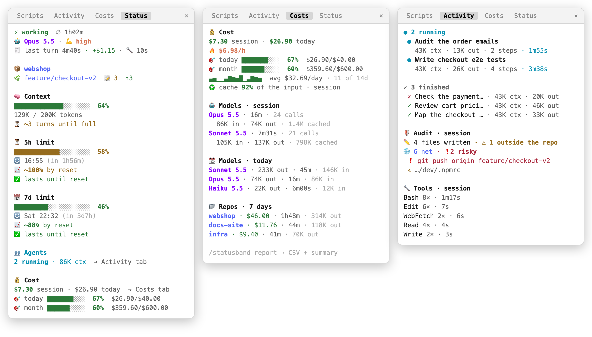
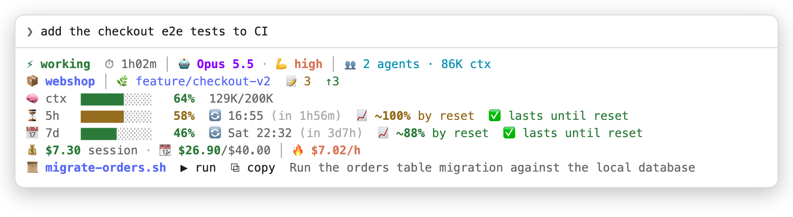

# statusband

A Claude Code mod: a colorful status sidebar beside the transcript, or a compact view under the prompt.

<picture>
  <source media="(prefers-color-scheme: dark)" srcset="docs/tabs-dark.png">
  
</picture>

Status: working/idle, model, effort, repo, context with a forecast of the turns left until it fills (`⏳ ~3 turns until full`, from the growth of the last turns), 5h and weekly limits with projected use at reset (`📈 ~20% by reset`, green under 90%, amber to 110%, red above) and run-out forecast, the last turn (time, cost, time spent in tools), and the session's and today's cost.

Costs: a separate **Costs** tab holds the session's and today's cost, burn rate, a 14-day sparkline of daily cost, the share of the input read from the cache (green from 80%, amber from 50%, red below: a drop means the cost goes up), tokens and time by model, and cost and time by repo over the last 7 days. `/statusband report [days]` (30 by default, up to 35) lists cost and time by repo and writes a CSV with one row per day and session (repo, session, start, cost, model minutes, calls, tokens, models) to your temp folder; cells that would start a spreadsheet formula are quoted. Beside it goes a Markdown summary: each day's cost, sessions, model time and top repo, and the 10 costliest turns (when, repo, cost, time, and the prompt's first 60 characters).

Budget: `/statusband budget day 20` and `/statusband budget month 300` set a cost budget (`day off`, `off` clear it; no argument shows where you stand). The Status and Costs tabs show a bar per budget, and the compact view colours today's cost: amber from 80%, red at 100%. At 80% a toast, at 100% a system notification as well, each once per day or month.

Activity: a separate **Activity** tab lists this session's subagents, running ones first, each with its context and output tokens, steps and time; finished ones keep their tokens (the last 20 are kept). When rows run short, rows fold so the finished ones stay in sight. The status pane keeps a one-line count of running agents. An agent that finishes while Claude waits on you sends a system notification. Below the agents, the tab lists this session's tools by time spent, with their call and error counts. Above them an **Audit** block counts the files the session wrote (and how many lie outside the repo; temp folders do not count), shell commands that reach another host (`curl`, `ssh`, `git push`/`fetch`, `gh`, `aws`…), risky ones (a forced push, `sudo`, a recursive `rm`, `curl … | sh`), fetched URLs, and denied tool calls, with the latest two flagged. `/statusband audit [days]` writes them to a CSV (time, repo, session, agent, kind, tool, tags, target). Commands are matched by pattern where they start, past `sudo` or `env`: a heuristic, not a shell parser. Closing the tab by hand keeps it closed until the next `/statusband`.

Models: every model call is counted by model, both the session's own and its subagents': tokens sent fresh (`in`, cache writes included), read back from the cache (`cached`), generated (`out`), the time the calls took, and how many there were. The Costs tab shows this session's use and today's across all sessions; `/statusband models` lists this session, today, the last 7 days, and the last 7 days by session (repo, start time, session id), newest first. Subagents running side by side each add their own time, so the total can exceed the wall-clock time.

Scripts: Claude is asked (a system prompt section) to hand you scripts as files in `.scripts/` of the working directory instead of pasting them. Each script belongs to the session that wrote it: the sidebar has a separate **Scripts** tab listing this session's newest five with **▶ run** (puts `! bash <path>` in the prompt box, Enter runs it, the output lands in the transcript) and **⧉ copy** (the file's exact text on the clipboard, no indentation). Under the prompt you get the newest one from this session; `/statusband run [name]` and `/statusband copy [name]` work everywhere. Other sessions' scripts show only as a count with **🧹 clean**, which deletes them (`/statusband clean` does the same) but spares any changed in the last 15 minutes, in case a session beside this one is using it; at session start, other sessions' scripts older than a week are deleted. Only files Claude wrote with a file tool count as a session's: anything else in the folder is treated as yours and never deleted. `run` and `copy` still find an older session's script by its name. Closing the Scripts tab by hand keeps it closed until the next `/statusband`. The folder ignores itself in git (`.scripts/.gitignore` holds `*`), unless it already held files of your own.

<picture>
  <source media="(prefers-color-scheme: dark)" srcset="docs/compact-dark.png">
  
</picture>

Where it shows: a sidebar docked beside the transcript in a fullscreen terminal (`/tui fullscreen`) and in the Desktop app; a compact multi-line view under the prompt in the classic renderer, or whenever the sidebar isn't on screen. `/statusband close` hides the sidebar, `/statusband` opens it again. Its four tabs open together in a fixed order, Scripts · Activity · Costs · Status, with Status on show; a tab closed by hand and asked for again brings the ones after it back behind it, so the order holds. Opened by itself the sidebar needs a 144-column terminal (110 once you've opened it by hand).

```bash
claude plugin test .   # engine-backed tests: the trees validate on terminal and desktop
```

Layout ideas were inspired by [claude-flightdeck](https://github.com/scasella/claude-flightdeck) (MIT); no code was copied.

No network calls: data comes from the mods API, local `git`, and the plugin's own `$.store`.

## What it touches

- **System prompt:** adds one short section asking Claude to hand you scripts as files in `.scripts/` (see Scripts above). Nothing else in the prompt changes.
- **`.scripts/` in the working directory:** writes `.scripts/.gitignore` (`*`) when the folder holds only Claude's scripts; deletes other sessions' scripts as described above. Files Claude did not write there, and a `.scripts` that is a symbolic link, are left alone.
- **Processes:** runs `git status` and `git rev-parse` in the working directory every 15 seconds, with `core.fsmonitor` off so a repository's config cannot run a command through it. **▶ run** only fills the prompt box: nothing runs until you press Enter.
- **Files elsewhere:** `/statusband-debug` writes `statusband-debug.json`, `/statusband report` writes `statusband-report-<date>.csv` and `.md`, `/statusband audit` writes `statusband-audit-<date>.csv`, all to your temp folder (`$TMPDIR`).
- **Notifications:** a system notification when a subagent finishes while Claude waits on you, and when a budget is spent.
- **Stored data** (the plugin's `$.store`): daily cost totals, and cost and per-model tokens and time by session, for 35 days, each session's repo name and start time, recent limit samples, which session wrote which script, your budgets, the costliest turns with the first 60 characters of their prompt, and the audit trail (paths written, flagged command lines up to 200 characters, fetched URLs). A command line can carry a secret such as a token in a `curl` header: the store and the audit CSV are plain local files.

## Requirements

Claude Code with the mods API (tested on 2.1.299). The sidebar needs the fullscreen terminal (`/tui fullscreen`) or the Desktop app; elsewhere you get the compact view.

## Develop

```bash
claude plugin validate .
claude --plugin-dir .      # hot-reloads on save
```

In a session, `/statusband-debug` prints the raw data the mod reads.

The screenshots are drawn from the mod's own render output, with made-up demo data, not taken from a live session.

## Install

At the prompt of a Claude Code terminal session:

```
/plugin install statusband --marketplace hkmt-sw/statusband
```

Answer `y` to add the marketplace, then pick a scope.

From a shell:

```bash
claude plugin marketplace add hkmt-sw/statusband
claude plugin install statusband@statusband
```

## License

MIT, see [LICENSE](LICENSE).
